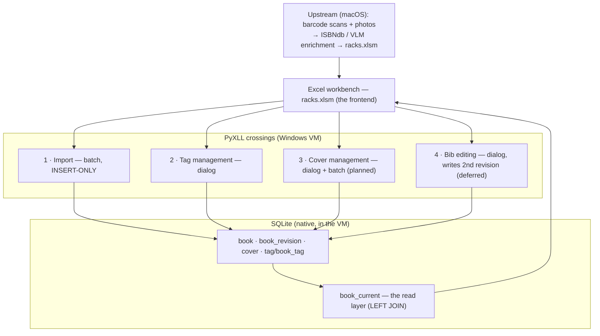

# haddolib

**Catalogue and curate a shared library of ~3,200 books.**

## 1 · What haddolib is

The "Magazin" is a dedicated basement room lined with IKEA Kallax shelving, holding a library Frank and his wife have built up over many years -- ~3,200 books there, plus ~400 elsewhere in the house. Two house moves and a flood scrambled the old order; haddolib is the tooling behind a systematic effort to catalogue everything and slowly restore a browsable one.

The system follows one philosophy: **human-curated, tool-assisted.** Excel (`racks.xlsm`) is the workbench and stays the frontend for the foreseeable future; a local SQLite database is becoming the master record beneath it, reached from Excel through PyXLL. Scripts and the database support the human work -- they don't replace it.

The load-bearing constraint, and the thing a newcomer most needs to hold: haddolib is **not** a generic library-management system. It is a tool for two people -- at most five, counting close friends and family -- and within that scope it may end up *more* tailored than any off-the-shelf LMS, precisely because it fits exactly one collection and one workflow. "Fits us exactly" and "no over-engineering" are the same instruction.

## 2 · Where it is right now

Two architectures live in the repository, and only one is worked on.

**The prototype is the active architecture** -- five tables and one view, Excel over local SQLite, enough to show basically all the books and their covers and to run the workflows that engage both users. Despite the name it is not a throwaway: "prototype" is now essentially a version label, and this design will do the heavy lifting for a long time. Where it ever conflicts with the older design, the prototype wins.

**The dream is hibernated** -- a richer five-grain model (`edition / edition_revision / copy / space / location_event`, plus a fuller `cover`) that proved *premature*, not wrong: sized for the full ambition when the near-term need was far smaller. It is parked -- kept green against its own schema but not developed against -- and every prototype omission has a documented, non-destructive growth path back to it.

Live today: the import crossing (batch, insert-only), the read layer, tag management, and the dump/export round-trip. Planned next: cover management and bibliographic editing, both dialog-driven. The physical track -- scanning and pre-curating in Excel -- is the bulk of the remaining human work and is nearly through the Magazin.

The full reasoning behind the pivot, the dream model in detail, and the project history live in `haddolib-design.md`, kept on the heap (out of the per-session filesdump) and pulled back only when a settled decision is genuinely re-opened. This README is the spine; §7 maps the rest of the docs.

## 3 · Architecture -- the spine

This section is enough to reason about the code without opening it. The shape: a mature upstream pipeline feeds an Excel workbench; four PyXLL "crossings" move data between Excel and a local SQLite database; everything that reads does so through one view.

### 3.1 · Physical model

Books live in IKEA Kallax units ("racks"), each subdivided into boxes numbered top-to-bottom, left-to-right when facing the rack. Racks 1–8 stand freestanding and load from **both sides** -- front and back are independent racks with their own box numbering; the rest stand against walls, front only. A book's address is recorded inline on its row as `room` / `space_label` / `bin_label` / `position`. Labels are **zero-padded on write** (`rack 03`, `box 07`) so a plain text sort equals natural shelf order -- this is what lets every query stay a dumb exact-match `WHERE` with no `LIKE` and no query-time normalisation. `position` is a `REAL`, so a book can be slotted at 1.5 between 1 and 2 without renumbering.

The upstream scanning pipeline (NETUM barcode scanner -> per-rack `.txt` files with `||BOX||` / `||PH||` control markers -> ISBNdb or local-VLM enrichment -> CSV -> the workbench) is mature, unchanged, and nearly complete; it is not part of the foundation work and is documented in `haddolib-design.md` on the heap.

### 3.2 · Schema -- five tables and one view

The grain is the anchor for everything else: **one row in `book` is one physical book.** Edition and copy are collapsed into it; the single retained duplicate in the whole collection is deferred to the dream rather than given a table (the reusable rule: *a structural layer whose real population is one belongs in a note, not a table*).

- **`book`** -- identity, inline location, workflow `book_status`, free `book_note`, and `preferred_cover_id`. The surrogate `book_id` is the **merge anchor**: it survives ingest, correction, and later relocation, so editing a location is a plain `UPDATE` and the id never moves. `isbn13` is **nullable and `UNIQUE`** -- SQLite treats NULLs as all-distinct, so every photo / pre-ISBN book coexists as NULL, while the `UNIQUE` guards against double-adding a real ISBN during messy incremental ingest.
- **`book_revision`** -- append-only, **words-only** bibliographic snapshots (no cover fields). Each row is a complete picture at one moment; newest wins. A blank field means *empty*, not *unchanged*.
- **`cover`** -- one row per image (`cover_ref`, `cover_source`, `cover_status`), zero-to-many per book. "Which to show" is the `book.preferred_cover_id` FK, not a flag -- a pointer can't be set on two rows at once, and `ON DELETE SET NULL` keeps it from dangling.
- **`tag` + `book_tag`** -- many-to-many, case-insensitive (`NOCASE` unique index; first spelling stored). The one genuine relational exception, kept because "books by tag, sorted by location" is on the wanted list.

### 3.3 · The read path

Everything reads **`book_current`**, never the base tables. The view is a `LEFT JOIN` from `book` to the newest revision (a `ROW_NUMBER() ... rn = 1` subquery, the predicate living in the `ON` clause) and to the preferred cover -- so a freshly-scanned, revisionless, or coverless book still appears, with NULL bibliographic or cover fields. This is the deliberate behaviour that makes "show basically all the books" true on day one.

`query_core.py` is pure and tested on macOS. It offers two entry shapes: a scalar `query(conn, name, ...)` dispatcher over the named statistics and location-hierarchy queries, and the list-returning functions (`books_by_bin` / `books_by_title` / `books_by_author` / `books_by_tags` / `all_books`), each returning `list[dict]` of all `book_current` columns plus a comma-joined `tags` key. Every list query orders by physical shelf position through the shared `_SHELF_ORDER` clause, so a tag search or a title search reads in the same sequence the books physically sit on the shelves.

### 3.4 · The write path and the four crossings

Data reaches the database only through PyXLL crossings, and only the first is batch-driven. **Crossing 1 (import) is insert-only** and flows through pure, separately-testable layers: `roster.py` maps one sheet row into book/revision/cover/tag buckets; `roster_import.py` writes a row and drives the batch (staggered dedup on isbn13-presence, per-row commit with error isolation, an itemised `ImportSummary`); `bridge_core.py` orchestrates and writes the rejected-rows xlsx; `pyxll_bridge.py` is the thin `@xl_macro` shell; VBA owns the button and the message box. Crossings 2–4 (tag, cover, bibliographic editing) are dialog-shaped; bib editing is the only path that ever writes a second revision, and is deferred past the current scope.

The per-row pipeline has **two sibling slots, by design**: *validators*, which reject a row with a stable reason code (`invalid_isbn13`, `status_blank`, ...), and *canonicalizers*, which coerce-and-normalise a messy-but-valid cell into stored form. The `date_published` canonicalizer (Excel date serials and float-year strings -> a clean stored date) is the current example. The two slots together express a standing direction: **migrate logic down out of the Excel layer into Python over time**, where it is testable and shared, rather than letting it accrete in worksheet formulas and VBA.

### 3.5 · The pure-core / thin-PyXLL split

This is the single most load-bearing architectural fact, and the reason the test suite looks the way it does. Every piece of real logic -- `roster`, `roster_import`, `bridge_core`, `query_core`, `tag_core`, `export_core`, `catalog`, `common` (except `common.write_xlsx`) -- depends only on the standard library and `sqlite3`, and is fully exercised on macOS (the suite runs green there). `pyxll_bridge.py` is reduced to marshalling and per-call connection open/close. So the Windows VM only ever has to prove that marshalling works, not that logic works -- which is why the project carries a large, confident test suite without a Windows CI rig.

### 3.6 · Export and the round-trip

`export_core.dump_db` writes the full catalogue (`all_books` + tags) to an xlsx whose headers are exactly the import vocabulary, so the file is directly re-importable. This makes the supported manual bib-correction loop possible until crossing 4 lands: **`make dump` -> edit the xlsx -> note the change in `revision_comment` -> bootstrap an empty DB -> re-import.** Field-name global uniqueness is what makes the round-trip safe (§4), and an import-time assertion fails loud if the dump's column list ever drifts from the import map. Known caveats: only the preferred cover and the newest revision survive a round-trip, orphan tags vanish, and the surrogate `book_id` is intentionally not preserved (new ids are minted on re-import).

## 4 · Contract -- boundaries new code must not break

These are the invariants downstream work has to honour. They are distinct from §5: this is *what must not be violated*, not *what was decided and why*.

**The VBA<->Python boundary.** VBA orchestrates and owns the UI; Python is a pure, stateless engine that never touches Excel's object model. Data flows VBA -> Python -> VBA. The boundary is deliberately dumb: input is a generic 2D structure of raw cell values (never a DataFrame -- pandas' NaN/dtype model would fight the coercion rule), and `common.as_text` / `as_int` / `as_real` is the single typing authority, with blank -> `None` -> NULL as the one rule the whole boundary trusts. The return channel is one delimited-string scalar that VBA splits into a dictionary; bulk results (rejected rows) go to a file on disk, not through that string. All validation lives in the import *driver*, not the bridgehead, so every decline lands in one unified summary and one rejected file.

**Field-name global uniqueness is load-bearing.** Every column name across the import/export vocabulary is unique and unambiguous -- `book_status`, `cover_status`, `revision_source`, `cover_ref`, and so on, with no dot-qualified disambiguation. This is not cosmetic: the dump and the import speak one vocabulary, which is the entire reason the round-trip (§3.6) is safe. Any future schema field must preserve this property; an import-time assertion enforces the dump/import halves cannot silently drift apart.

**The handle contract (read path).** List queries return opaque handle strings (`haddo:{session}:{kind}:{token}`) into a private catalog; VBA consumes them through kind-agnostic `haddo_len` / `haddo_get_field` / `haddo_release`. The kind is diagnostic only -- VBA never needs to know which query produced a handle. Handles carry a TTL and are swept; a session prefix makes handles from a previous reload obviously stale. Raw SQL from VBA was considered and rejected, so query logic and schema coupling stay centralised in `query_core`.

**Location is canonical on write.** Zero-padded labels are produced in Python at ingest, never normalised at query time -- so reads stay dumb exact-match, and shelf-ordering (§3.3) is correct precisely because the labels are consistently padded.

## 5 · Running and testing

The database lives natively in the Windows VM; tests use an ephemeral in-memory database. Every connection is opened through `database.connect`, which applies the contract above. **The default schema is the prototype** (`data/haddolib_prototype.sql`) -- the dream schema is loaded only by its own hibernated suite, by explicit path.

Common targets (OS-aware -- macOS and the Windows VM):

- **`make test`** -- the full pure-Python suite (runs on macOS; this is the working loop).
- **`make dump`** -- write a full catalogue snapshot to a timestamped, re-importable xlsx in `data/import/`.
- **`make bootstrap`** -- create an empty database from the prototype schema.

The supported manual bib-correction loop (until crossing 4): `make dump` -> edit the xlsx -> note the change in `revision_comment` -> `make bootstrap` -> re-import.

One known constraint worth stating up front: title and author search fold case with SQLite's built-in `lower()`, which is ASCII-only -- it does not casefold German umlauts (a search for `müller` will not match `Müller`). This is a noted limitation, not a solved problem; the fix path (an ICU collation or a folded shadow column) is on the backlog.
