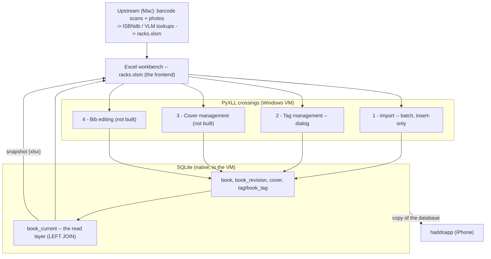

# haddolib

**Catalogue and curate a shared library of ~3,200 books.**

## 1 What haddolib is

The "Magazin" is a basement room lined with IKEA Kallax shelving, holding a library Frank and his wife have built up over many years -- ~3,200 books there, plus ~400 elsewhere in the house. Two house moves and a flood scrambled the old order; haddolib is the tooling behind a systematic effort to catalogue everything and slowly restore a browsable one.

The system follows one philosophy: **human-curated, tool-assisted.** Excel (`racks.xlsm`) is the workbench and the frontend; a local SQLite database is the master record beneath it, reached from Excel through PyXLL. Scripts and the database support the human work -- they don't replace it.

haddolib is **not** a generic library-management system. It is a tool for two people -- at most five, counting close friends and family -- and within that scope it may end up *more* tailored than any off-the-shelf system, because it fits exactly one collection and one workflow. "Fits us exactly" and "no over-engineering" are the same instruction.

## 2 Where it is now

- **Database:** five tables and one view, created from `data/haddolib_default_schema.sql` (`DEFAULT_SCHEMA` in `database.py`).
- **Live in Excel:** the import (crossing 1), the bookshelf view and the read queries, tag management (crossing 2), and the +/- snapshot cycle (section 4).
- **Not built yet:** cover management (crossing 3) and bibliographic editing (crossing 4).
- **Siblings:** haddoapp shows the library on the iPhone, read from a copy of the database; `pdf-annotations` gets ISBNdb synopses for its PDF library from haddolib's scripts (section 5).
- **Physical track:** scanning is nearly through the Magazin; rack 15 (cookbooks) and ~400 books elsewhere in the house remain.

The record of what was built and when is in `HISTORY.md`; where the project goes next is in `GOALS.md`; concrete open work is in `TODO.md`.

## 3 Architecture

Upstream scripts on the Mac feed the Excel workbench; PyXLL "crossings" move data between Excel and the SQLite database in the Windows VM; everything that reads does so through one view.



### 3.1 Physical model

Books live in IKEA Kallax units ("racks"), each subdivided into boxes numbered top-to-bottom, left-to-right when facing the rack. Configurations in use: 4x4, 5x5, 3x4, 2x4, 2x5 and 2x2 boxes; about 15 racks and 256 boxes. Racks 1-8 stand freestanding and load from **both sides** -- front and back are separate racks with their own box numbering; the rest stand against walls, front only.

A book's address is stored on its row as `room` / `space_label` / `bin_label` / `position`. "Space" and "bin" are the general terms; in the Magazin a space is a rack and a bin is a box, stored as labels like `rack 03` and `box 07`. haddoapp shows them as "Regal" and "Fach". The labels are zero-padded, so a plain text sort is the shelf order; they were generated in Excel when the first import was built from the scanning protocols. `position` is a `REAL`, so a book can be slotted in at 1.5 between 1 and 2.

The upstream scanning pipeline: a NETUM barcode scanner writes one `.txt` file per rack, with control barcodes for `||BOX||` (next box), `||PH||` (photo taken, no usable barcode), `||DEL||` and `||END||` (`tools/control_sheet.py` prints the control sheet). ISBNs are looked up through ISBNdb (`scripts/isbndb_*.py`), books without a barcode are read from a cover photo by a local vision model (`scripts/photo_analysis.py`), and covers are downloaded into `data/covers/` (`scripts/cover_download.py`). The results land in `racks.xlsm`.

### 3.2 Schema -- five tables and one view

One row in `book` is one physical book.

- **`book`** -- identity, inline location, `book_status`, free `book_note`, and `preferred_cover_id`. `book_id` is the key that `book_revision`, `cover` and `book_tag` point at. It stays the same while a book is corrected or moved within one database; a bootstrap and re-import (the +/- cycle, section 4) gives every book a new `book_id`. `isbn13` is nullable and `UNIQUE`: SQLite treats NULLs as all different, so every photo or pre-ISBN book can be NULL, while a real ISBN can't be added twice.
- **`book_revision`** -- append-only bibliographic snapshots, words only (no cover fields). Each row is a complete picture at one moment; the newest wins. A blank field means *empty*, not *unchanged*.
- **`cover`** -- one row per image (`cover_ref`, `cover_source`, `cover_status`), zero to many per book. Which cover to show is `book.preferred_cover_id`; `ON DELETE SET NULL` keeps it from pointing at a deleted cover.
- **`tag` + `book_tag`** -- many-to-many, case-insensitive (`NOCASE` unique index; the first spelling is stored).
- **`book_current`** -- the view everything reads. A `LEFT JOIN` from `book` to its newest revision and to its preferred cover, so a book without a revision or a cover still appears, with NULL in those fields.

### 3.3 The read path

Everything reads `book_current`, never the base tables. `query_core.py` offers two kinds of entry point:

- **`query(conn, name, *params)`** -- a dispatcher over the named statistics and location queries (rooms, spaces, bins, counts by status, source and so on). Excel calls it as `haddo_query(name, ...)`.
- **List queries** -- `books_by_bin`, `books_by_title`, `books_by_author`, `books_by_tags`, `books_by_ids` and `all_books`, each returning `list[dict]`: all `book_current` columns plus a `tags` key (comma-joined, sorted alphabetically). Each orders by `room, space_label, bin_label, position`, so results read in the order the books stand on the shelves. Title and author search is case-insensitive substring search.

The list queries reach Excel as opaque handles (section 5.4). `tag_stats` lists every tag with its count, orphans included; `haddo_tag_stats` returns it as a 2D range.

### 3.4 The write path

Data reaches the database only through PyXLL crossings.

**Crossing 1, the import, is batch-driven and insert-only.** It runs through pure layers:

- `roster.py` maps one sheet row into book / revision / cover / tag parts (`FIELD_MAP`).
- `roster_import.py` writes a row and drives the batch: duplicates are found by `isbn13`, or, for a book without an ISBN, by its photo `cover_ref` among photo books; each row commits on its own, and a row that fails is recorded without stopping the run; an `ImportSummary` counts every outcome.
- `bridge_core.py` parses the block, writes the rejected file and packs the summary string.
- `pyxll_bridge.py` is the thin `@xl_macro` shell (`haddo_import`); VBA owns the button and the message box.

A row is rejected with one of these reason codes: `non_numeric_value` (text in a numeric column, checked before mapping), `invalid_isbn13` (wrong check digit), `duplicate_isbn13`, `duplicate_photo`, `no_key` (neither ISBN nor photo), `status_blank` and `incomplete_location` (a bin without a space, or a space without a room). Each check is a small function; adding one means appending a function and a test.

**Crossing 2, tag management,** is dialog-driven: `tag_core.set_tags` replaces all tags of a book (unknown tags are created); `haddo_set_tags` commits it, and `haddo_refresh_handle` reloads the books behind a handle so the bookshelf shows the change.

### 3.5 Pure core, thin PyXLL

All real logic -- `roster`, `roster_import`, `bridge_core`, `query_core`, `tag_core`, `snapshot_core`, `catalog`, `common` -- uses only the standard library and `sqlite3` (plus `openpyxl` for `common.write_xlsx`) and is tested on the Mac. `pyxll_bridge.py` only marshals values and opens and closes a connection per call. So the Windows VM only has to prove that marshalling works, not that logic works.

## 4 The +/- cycle

Corrections to the library are made in Excel, and the database is rebuilt from them. One cycle, here for books whose `cover_status` is `missing`:

1. `make snapshot` (in the VM) writes the whole library to `data/import/YYYYMMDD_HHMMSS_snapshot.xlsx`.
2. Copy the snapshot into a new sheet of `racks.xlsm`.
3. Filter `cover_status <> missing` and copy those rows to a "- missing" sheet: the part that stays as it is.
4. Filter `cover_status = missing` and copy those rows to a "+ missing" sheet: the part to work on.
5. Work on the "+" rows -- here: take a photo, enter its file name in `cover_ref`, set `cover_source` to `own_photo` and `cover_status` to `missing_fixed`.
6. `make bootstrap` (in the VM) re-creates an empty database. It asks before deleting the existing one.
7. Press "import" on the "-" sheet, then on the "+" sheet.
8. `make snapshot` again -- the start of the next cycle.

Each import sheet is a copy of an earlier one, so it already has its "import" button and a defined name for the import block:

```
=BEREICH.VERSCHIEBEN('import 3 (+missing)'!$A$1;0;0;ANZAHL2('import 3 (+missing)'!$B$1:$B$5000);ANZAHL2('import 3 (+missing)'!$A$1:$AT$1))
```

The rows are counted in column B, which is `room` in a snapshot: a row with an empty `room` shortens the block, and the rows at the end are left out. `Import.bas` hands the named block to `haddo_import`.

Opening a snapshot needs no type settings: it is an xlsx with typed cells, so ISBNs stay text (leading zeros included) and numbers like `height_cm` stay numbers.

Excel prepares the data before it reaches the import: the `STRINGDATUM` lambda in `racks.xlsm` turns a year number into `"2004"`, a date serial into `"YYYY-MM-DD"`, and keeps text as it is; the rack and box labels come from Excel too (section 3.1).

`racks.xlsm` holds every cycle's sheets, so the database could in principle be rebuilt by replaying them in order.

**What does not survive a cycle:** only the preferred cover and the newest revision of each book go into a snapshot; tags without any book disappear; and every book gets a new `book_id`.

## 5 Contracts

These are the boundaries the code relies on.

### 5.1 VBA <-> Python

- VBA orchestrates and owns the UI; Python is stateless and never touches Excel's object model. Data flows VBA -> Python -> VBA.
- The import receives a named range as a 2D structure of raw cell values. `common.as_text` / `as_int` / `as_real` do all the typing; a blank cell becomes `None`, which becomes NULL.
- The import returns one string: `key<TAB>value` lines, which VBA splits into a dictionary. Bulk results (rejected rows) go to a file on disk, whose path is in that string (`rejected_rows_file`).
- `racks.xlsm` is the source of truth for the VBA code. `bas/` holds exported copies, kept for reading; they are never edited or imported back.

### 5.2 The import vocabulary

- `roster.FIELD_MAP` maps header strings to columns. Column order is free; a blank header skips the column; an unknown header is reported, never fatal. `tags` is comma-separated.
- Every column name is unique across the whole vocabulary (`book_status`, `cover_status`, `revision_source`, `cover_source`, ...), so no name needs a table prefix.
- A snapshot's columns (`snapshot_core.SNAPSHOT_FIELDS`) are exactly the `FIELD_MAP` keys plus `tags`, so a snapshot can be imported as it is. A check at import time raises an error if the two ever drift apart.

### 5.3 The rejected file

- `data/import/YYYYMMDD_HHMMSS_rejected.xlsx`, one per import run, with typed cells.
- Columns: `rejected_reason` (the reason code, or the error message), `rejected_detail` (the offending cell, for field-level checks), then the original row unchanged.
- It can be fixed and imported again: the import strips a leading `rejected_reason` and `rejected_detail` column.
- `data/import/` is git-ignored and must exist; the code does not create it.

### 5.4 Handles

List queries reach Excel as opaque handle strings, `haddo:{session_id}:{kind}:{token}`, kept in a catalog (`catalog.py`). VBA reads them through `haddo_len`, `haddo_get_field` and `haddo_release`, which work for every kind of handle. Handles expire after 600 seconds unused (`haddo_sweep_handles` removes them); the session part makes handles from before a PyXLL reload recognisably stale. `haddo_get_field` names the available fields when asked for an unknown one.

### 5.5 haddoapp

haddoapp reads a copy of the live database (its README describes how the copy is made) and never writes to it. It relies on:

- the `book_current` columns `book_id`, `isbn13`, `title`, `authors`, `room`, `space_label`, `bin_label`, `position` and `cover_ref`;
- the tables `book_tag` (`book_id`, `tag_id`) and `tag` (`tag_id`, `name`);
- the `cover_ref` rule: a URL means the file named after the last part of the URL, in `data/covers/` (as `cover_download.py` saves it); anything else is a file name in `data/photos/`.

haddoapp keeps a copy of `data/haddolib_default_schema.sql` in its `docs/`, identical to haddolib's.

### 5.6 pdf-annotations

`pdf-annotations` manages a library of PDFs named `(Author[+Author...] YYYY[a]) Title.pdf`. haddolib fetches their synopses from ISBNdb:

- `make pdf-lst-to-queries` turns `data/input/pdfs.lst` (a list of PDF file names) into `data/output/pdfs_query.csv`.
- `make isbndb-synopsis` writes one `<pdf_id>.txt` per PDF into `~/Obsidian/Papers/Collection/Synopses`, where `pdf_id` is the part in parentheses. A file with text is a synopsis (UTF-8 with BOM); an empty file means "looked up, nothing found". Existing files are skipped unless `--force` is given.
- `pdf-annotations` reads that folder (`make fill-synopses` there). The folder and the file format are the whole contract; no code is shared.

## 6 Running

### 6.1 Where things run

| | Mac | Windows VM (Parallels) |
|---|---|---|
| Repository | `~/Projects/haddolib` | the same folder, through the Parallels share |
| Python env | `.venv` | `.venv-win` (adds `pyxll`) |
| Runs | `make test`, all `scripts/` (ISBNdb, VLM, covers, synopses), haddoapp | `racks.xlsm`, PyXLL, the live database, `make bootstrap` / `backup` / `snapshot` |

The `Makefile` works on both sides (Git Bash and GNU Make in the VM).

### 6.2 The database

- The live database is `C:\SQLite\haddolib\haddolib.db`, on the VM's own disk (`DEFAULT_DB` in `database.py`). It is never in git.
- Every connection is opened through `database.connect`: foreign keys on, rollback journal (`DELETE`), rows readable by column name.
- `make backup` copies it with SQLite's backup API into a timestamped folder under `Y:\Projects\haddolib\bak` and `X:\SQLite-bak\haddolib`.
- Tests use a fresh in-memory database per test (`empty_db` in `tests/conftest.py`).

### 6.3 Make targets

- **`make test`** -- the whole test suite (on the Mac; also runs in the VM).
- **`make snapshot`** -- write the whole library to `data/import/YYYYMMDD_HHMMSS_snapshot.xlsx`.
- **`make bootstrap`** -- re-create an empty live database from the schema; asks before deleting the existing one.
- **`make backup`** -- back up the live database (see above).
- **`make isbndb-lookup` / `isbndb-search` / `isbndb-query`** -- ISBNdb lookups by ISBN, by free-text list, or one query with all editions.
- **`make photo-analysis`** -- read title and author from cover photos with a local vision model (Ollama).
- **`make pdf-lst-to-queries` / `isbndb-synopsis`** -- the synopses for `pdf-annotations` (section 5.6).
- **`make help`** lists all targets.

`scripts/openlibrary_lookup.py` (ISBN lookup through Open Library, the first provider) has no make target.

### 6.4 Known limitation

Title and author search fold case with SQLite's built-in `lower()`, which handles ASCII only: a search for `müller` does not find `Müller`.
